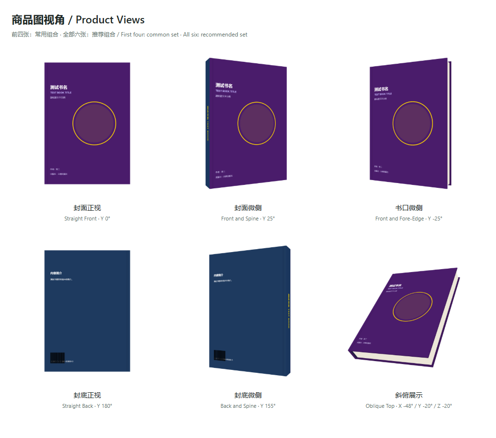

# 立体书样机生成器 / Book 3D Generator

**当前版本 / Current version: `1.2.0`**

**下载 / Downloads**

稳定版发布页 / Stable release: [GitHub v1.2.0](https://github.com/CommonerOfWestWall/book-3d-generator/releases/tag/v1.2.0)

- [Windows x64 portable EXE](https://github.com/CommonerOfWestWall/book-3d-generator/releases/download/v1.2.0/book-3d-generator_1.2.0_windows-x64.exe)
- [Windows x64 installer](https://github.com/CommonerOfWestWall/book-3d-generator/releases/download/v1.2.0/book-3d-generator_1.2.0_windows-x64-setup.exe)
- [SHA256SUMS.txt](https://github.com/CommonerOfWestWall/book-3d-generator/releases/download/v1.2.0/SHA256SUMS.txt)

## 中文

### 定位与范围

Windows x64 桌面端的封面展开图 3D 样机工具。结果是近似展示用 mockup，不是印刷生产文件，也不替代印厂的出血、装订或纸张规格校验。

支持闭合平装和闭合平直书脊精装；不提供开书、圆脊、书衣或其他未列出的模型。精装几何包含板厚、出飘、书脊接缝和页面内缩等可调估算。输入是一张水平展开图：

```text
[封底 / back] [书脊 / spine] [封面 / front]
```

两端可以带可选外勒口（outer flaps）。

### 1.2.0 工作流

- Tauri 2 Windows 壳提供轻量桌面运行路径，不显示黑色控制台窗口。
- 界面分为四个标签页：`封面`、`书型`、`视角`、`导出`（Cover / Structure / View / Export）。
- `封面`裁切支持数字输入和指针拖拽：红色书脊左右边界，以及启用`裁切两端勒口`后的蓝色勒口左右边界。`取消`、Esc 和关闭按钮事务性取消本次修改，重新打开恢复已提交值。
- `书型`提供闭合平装与闭合平直书脊精装；精装的板厚、出飘、接缝和页面内缩用于近似展示，不是物理毫米规格。
- 改善微侧视角下的书脊清晰度；纹理按 sRGB 读取并用于导出，导出前会检查画布和纹理是否已准备好。
- 常用四张为`封面正视`、`封面微侧`、`书口微侧`、`封底正视`；推荐六张再加`封底微侧`、`斜俯展示`。角度依据公开商品图抽样校准，不是平台强制标准，见[视角参考与保存说明](docs/product-views.md)。
- `视角`页可为 X/Y/Z 旋转、镜头距离和高度命名保存，支持应用、更新、重命名、删除。`导出`页支持内置视角与自定义视角混合选择，也可直接选择常用四张、推荐六张或我的视角。
- 批量导出在结束、失败或取消后恢复原视角；空选择禁用批量导出。原生保存或文件夹对话框取消会被尊重，不会偷偷改用浏览器下载。
- 视角和批量选择保存在当前 Windows 用户的本地应用存储中，重启后保留，不上传到服务器。应用标识保持为 `com.book3d.generator`；设置不会随 `.exe` 文件夹迁移到其他电脑，也不会自动跨电脑迁移。清除本地应用数据会丢失设置；存储读取异常时保留原数据并禁用修改，写入失败时保留原设置并提示错误。




### 导出与文件格式

- 预览为自适应正方形画布，与导出构图一致；边长为 `1024`、`1920` 或 `2560` 像素。
- PNG 支持透明或白色背景；JPG 使用白色背景。
- 支持单张导出和混合内置/自定义视角的批量导出。批量下载可能需要允许浏览器下载多个文件。
- 生成文件用于展示，不是印刷生产文件；仍需自行核对出血、装订、纸张和色彩管理要求。

### 下载与安装

- portable EXE：下载后直接运行，不需要安装向导或额外的应用资源文件。
- installer：运行 NSIS 安装包，按向导选择安装位置，可创建快捷方式。
- Tauri 2 需要 WebView2。独立 EXE 需要系统已有运行时；安装包默认在缺失时联网下载 WebView2 安装引导程序，因此离线环境应提前安装运行时。WebView2 本身不内置于下载包。
- 发布构建未签名时可能显示 Windows 安全警告。不要通过关闭或禁用杀毒软件来处理该警告。
- SHA-256 校验值见发布页中的 `SHA256SUMS.txt`，可用 PowerShell 的 `Get-FileHash -Algorithm SHA256` 核对。

### 开发、构建与验证

需要 Windows x64、Node.js 和 npm：

```bash
npm ci
npm test
npm run check:release -- v1.2.0
npm run test:ui
```

`npm test` 使用 Node 内置测试运行几何、视角数据和发布检查。`npm run test:ui` 使用外部 Playwright，并在可用时通过 Edge；若本机未解析到 Playwright，可按本机配置提供 `NODE_PATH`，不需要新增依赖。

Tauri 开发与构建还需要 Rust、Windows MSVC 工具链以及系统已安装的 WebView2：

```bash
npm run tauri:dev
npm run tauri:build
```

Electron 入口仍保留，作为开发兼容路径，不是 1.2.0 官方下载渠道：

```bash
npm start
npm run build
```

### 目录要点

`renderer/index.html`（界面、Three.js 场景、裁切与导出运行时）、`renderer/book-model.js`（精装几何）、`renderer/three.min.js`（vendored Three.js r128）、`tests/`（Node 几何与浏览器工作流）、`src-tauri/`（Tauri 2 壳与原生文件操作）。

## English

### Scope

Book 3D Generator is a Windows x64 desktop tool that turns a flat cover spread into a 3D presentation mockup. It is not a print-production file and does not replace printer checks for bleed, binding, paper specifications or color management.

Only closed paperback and closed flat-spine hardcover models are supported. Open-book, rounded-spine and dust-jacket models are outside scope. Hardcover controls estimate board thickness, overhang, spine joint and page inset for presentation.

The input is one horizontal spread:

```text
[back] [spine] [front]
```

Optional outer flaps may be included at both ends.

### 1.2.0 workflow

- The Tauri 2 Windows shell provides a lightweight desktop path without a black console window.
- The four UI tabs are `封面` (Cover), `书型` (Structure), `视角` (View), and `导出` (Export).
- The `封面` crop dialog supports numeric input and pointer dragging for red spine boundaries and, when enabled, blue outer-flap boundaries. `取消` (Cancel), Esc and the close button discard the uncommitted edit; reopening restores committed values.
- `书型` offers closed paperback and closed flat-spine hardcover. Board thickness, overhang, joint and page inset are display estimates, not physical millimetre specifications.
- Improved spine clarity at shallow side angles. Textures are read as sRGB for rendering and export, with readiness checks before export.
- The common four views are straight front, front and spine, front and fore-edge, and straight back. The recommended six add back and spine plus oblique top. These are qualitative listing-based calibrations, not platform requirements; see [view references and saved settings](docs/product-views.md).
- The `视角` tab saves named X/Y/Z rotation, camera distance and height, with apply, update, rename and delete actions. The `导出` tab supports mixed built-in and saved-view selections, plus common four, recommended six and custom-view sets.
- Batch export restores the original camera after completion, failure or cancellation; an empty selection disables it. Native save and folder-dialog cancellation are honored rather than silently switching to browser downloads.
- Views and batch selections persist in local storage for the current Windows user and are not uploaded. The application identity remains `com.book3d.generator`; settings do not travel with an `.exe` folder or automatically migrate between computers. Clearing local application data removes settings. Invalid storage is retained with editing disabled, and failed writes keep the previous settings while reporting an error.

### Export and file formats

- The responsive square preview matches export framing; output dimensions are `1024`, `1920` or `2560` pixels per side.
- PNG supports transparent or white backgrounds; JPG uses white.
- Single-view and mixed built-in/custom batch export are supported. Browsers may require permission for multiple downloads.
- Outputs are for presentation, not print production; verify bleed, binding, paper and color requirements separately.

### Download and installation

- Portable EXE: run it after download without an installer or additional application resource files.
- Installer: run the NSIS package and choose an installation directory; shortcuts can be created.
- Tauri 2 requires WebView2. The standalone EXE needs an existing runtime; by default, the installer downloads the WebView2 bootstrapper when the runtime is missing. Offline systems should install the runtime beforehand. WebView2 itself is not bundled.
- Unsigned release builds may show a Windows security warning. Do not disable antivirus software to handle it.
- Use `SHA256SUMS.txt` from the release page for SHA-256 verification with PowerShell's `Get-FileHash -Algorithm SHA256`.

### Development and verification

Requirements are Windows x64, Node.js and npm:

```bash
npm ci
npm test
npm run check:release -- v1.2.0
npm run test:ui
```

`npm test` runs geometry, saved-view data and release checks with Node's built-in test runner. `npm run test:ui` uses external Playwright and Edge when available; provide `NODE_PATH` according to the local setup if Playwright is not resolved. No dependency is added for that setup.

Tauri development and builds also require Rust, the Windows MSVC toolchain and WebView2:

```bash
npm run tauri:dev
npm run tauri:build
```

The Electron entry remains as a development compatibility path, not the official 1.2.0 download channel:

```bash
npm start
npm run build
```

See [CHANGELOG.md](CHANGELOG.md) and the [v1.2.0 release notes](docs/releases/v1.2.0.md) for the bounded release record.

MIT; see [LICENSE](LICENSE).
