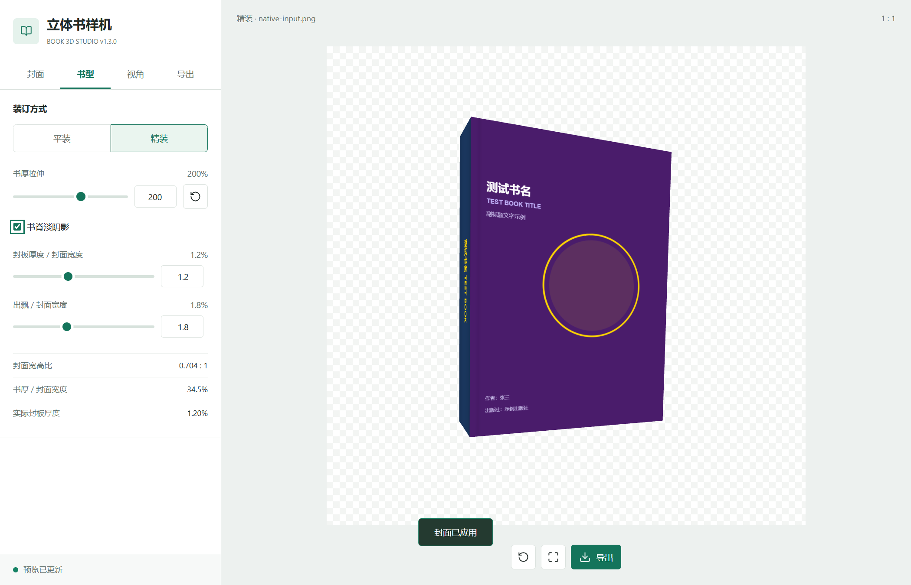
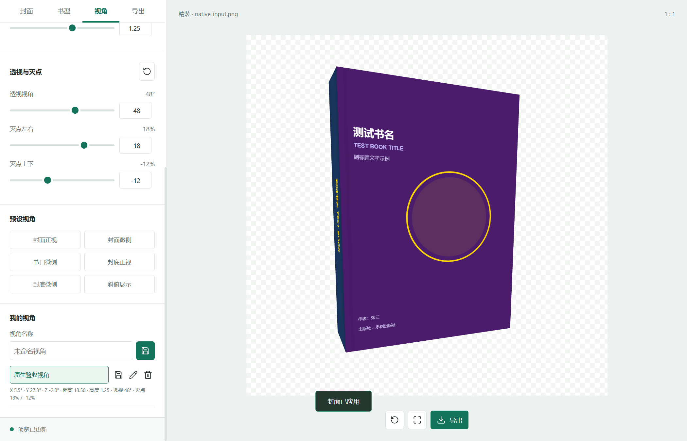
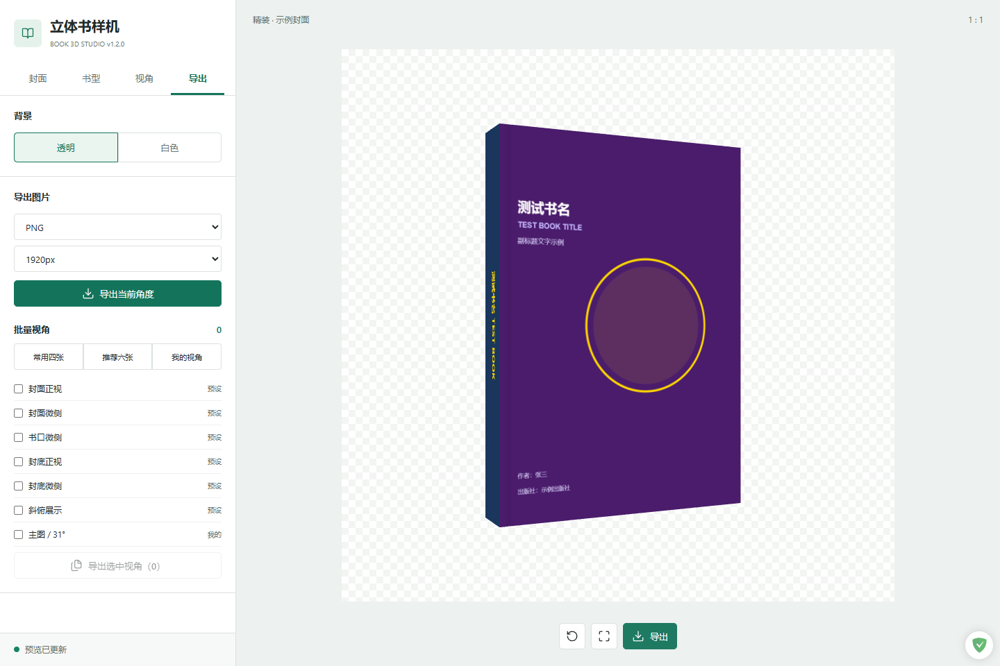

# 立体书样机生成器 / Book 3D Generator

**当前稳定版本 / Current stable version: `1.3.0`**

**已发布下载 / Published downloads**

稳定版发布页 / Stable release: [GitHub v1.3.0](https://github.com/CommonerOfWestWall/book-3d-generator/releases/tag/v1.3.0)

- [Windows x64 portable EXE](https://github.com/CommonerOfWestWall/book-3d-generator/releases/download/v1.3.0/book-3d-generator_1.3.0_windows-x64.exe)
- [Windows x64 installer](https://github.com/CommonerOfWestWall/book-3d-generator/releases/download/v1.3.0/book-3d-generator_1.3.0_windows-x64-setup.exe)
- [SHA256SUMS.txt](https://github.com/CommonerOfWestWall/book-3d-generator/releases/download/v1.3.0/SHA256SUMS.txt)

历史版本 / Previous release: [v1.2.0](https://github.com/CommonerOfWestWall/book-3d-generator/releases/tag/v1.2.0)

## 中文

### 定位与范围

Windows x64 桌面端的封面展开图 3D 样机工具。结果是近似展示用 mockup，不是印刷生产文件，也不替代印厂的出血、装订或纸张规格校验。

支持闭合平装和闭合平直书脊精装；不提供开书、圆脊、书衣或其他未列出的模型。精装几何包含板厚、出飘、书脊接缝和页面内缩等可调估算。输入是一张水平展开图：

```text
[封底 / back] [书脊 / spine] [封面 / front]
```

两端可以带可选外勒口（outer flaps）。

### 1.3.0 工作流

- Tauri 2 Windows 壳提供轻量桌面运行路径，不显示黑色控制台窗口。
- 界面分为四个标签页：`封面`、`书型`、`视角`、`导出`（Cover / Structure / View / Export）。
- `封面`裁切支持数字输入和指针拖拽：红色书脊左右边界，以及启用`裁切两端勒口`后的蓝色勒口左右边界。`取消`、Esc 和关闭按钮事务性取消本次修改，重新打开恢复已提交值。
- `书型`提供闭合平装与闭合平直书脊精装；精装的板厚、出飘、接缝和页面内缩用于近似展示，不是物理毫米规格。
- 改善微侧视角下的书脊清晰度；纹理按 sRGB 读取并用于导出，导出前会检查画布和纹理是否已准备好。
- 常用四张为`封面正视`、`封面微侧`、`书口微侧`、`封底正视`；推荐六张再加`封底微侧`、`斜俯展示`。角度依据公开商品图抽样校准，不是平台强制标准，见[视角参考与保存说明](docs/product-views.md)。
- `视角`页可为 X/Y/Z 旋转、镜头距离、高度、透视视角和两个灭点偏移共 8 个字段命名保存，支持应用、更新、重命名、删除。`导出`页支持内置视角与自定义视角混合选择，也可直接选择常用四张、推荐六张或我的视角。
- 批量导出在结束、失败或取消后恢复原视角；空选择禁用批量导出。原生保存或文件夹对话框取消会被尊重，不会偷偷改用浏览器下载。
- 视角和批量选择保存在当前 Windows 用户的本地应用存储中，重启后保留，不上传到服务器。应用标识保持为 `com.book3d.generator`；设置不会随 `.exe` 文件夹迁移到其他电脑，也不会自动跨电脑迁移。清除本地应用数据会丢失设置；存储读取异常时保留原数据并禁用修改，写入失败时保留原设置并提示错误。

### 透视控制 / Perspective controls

- `视角` / `View` 页新增 `FOV`（透视视角 / perspective view angle）控制，范围 `10`–`70` 度，默认 `35` 度。它会补偿相机距离，使书的中心平面大致保持稳定构图；它不同于改变书厚度或旋转。
- 较小角度更扁平，较大角度近大远小更明显。调节时若书体接近画布边界，会自动退远镜头防止裁边；旋转和镜头高度不变，仍可手动调整镜头距离。
- 新增镜头主点/消失点偏移：水平和垂直均为 `-40%`–`40%`，默认 `0%`；正水平值向右，正垂直值向上。`还原透视` / Reset perspective 按钮恢复 `FOV=35`、水平 `0%`、垂直 `0%`。
- 这里移动的是镜头的主点/透视消失点，不是宣称书的所有边缘都收敛到同一个点；方向性 3D 书边仍可保留多个消失点。
- 保存的视角共有 8 个字段：`az`、`el`、`rotZ`、`zoom`、`height`、`fov`、`vanishX`、`vanishY`。旧的 5 字段保存记录会读取为 `fov=35`、`vanishX=0`、`vanishY=0`，原始旧存储不会被自动改写；内置视角显式使用默认投影，切换内置视角会重置投影设置。
- 新版优先读取 v2；仅在 v2 存储键不存在时读取旧版 v1 记录。首次读取不会自动写入，用户修改视角或批量选择时才保存到独立的 v2 存储，不覆盖旧版存储；之后两套存储各自独立，旧版后来新增或修改的视角不会自动同步到 1.3.0。
- 批量导出按每个已保存视角的完整设置执行，并在结束、失败或取消后恢复全部 8 个视角字段。重启只持久化已保存视角，不会自动持久化未保存的当前活动视角。

### 脊厚调整 / Spine thickness

> 书厚是会话状态，不写入保存视角；重启恢复默认 `100%`。/ Thickness is session-only, is not stored in saved views, and restarts at `100%`.

- 在`书型` / `Structure`页使用书厚拉伸滑块或数字输入，将书脊和书体深度按 `50%`–`300%` 调整，步长为 `5%`；`还原书厚`图标按钮恢复 `100%`。
- 该调整只拉伸 3D 书脊/书体深度，封面展开图、已裁切的书脊与勒口边界、封面宽高和相机不会改变；书脊图像会随厚度一起拉伸，可直接在预览中检查。
- 预览、单张导出和批量导出使用同一当前脊厚值，因此可在预览确认后导出全部选中的视角。数值超出范围时会限制在 `50%`–`300%`。
- 保存的视角只保存相机参数，不保存书厚。当前会话中切换书型、重新裁切或换封面会保留拉伸比例，并根据新裁出的书脊计算厚度；重启应用恢复 `100%`。

### 书脊淡阴影 / Subtle spine shadow

- 在`书型` / `Structure` 面板勾选`书脊淡阴影` / `Spine shadow`，为两种书型的当前书脊启用轻微的中心原色、边缘较暗顶点色调。默认关闭；仅作用于预览、单张图片（PNG/JPG）和批量导出，不会重采样或模糊封面图，也不会改变几何边界。
- 该选项只在当前会话保留，会随书型切换、书厚调整、重新裁切和重建继续生效；保存的视角仍只保存相机参数。重启应用后复位为未勾选。
- 导出进行中该复选框会禁用。可用键盘聚焦并按空格切换，也可点击关联标签；本地回归输出会写入指定的 `BOOK3D_TEST_OUTPUT` 目录。







### 导出与文件格式

- 预览为自适应正方形画布，与导出构图一致；边长为 `1024`、`1920` 或 `2560` 像素。
- PNG 支持透明或白色背景；JPG 使用白色背景。
- 支持单张导出和混合内置/自定义视角的批量导出。批量下载可能需要允许浏览器下载多个文件。
- 生成文件用于展示，不是印刷生产文件；仍需自行核对出血、装订、纸张和色彩管理要求。

### 下载与安装

- portable EXE：下载后直接运行，不需要安装向导或额外的应用资源文件。
- installer：运行 NSIS 安装包，按向导选择安装位置，可创建快捷方式。
- Tauri 2 需要 WebView2。独立 EXE 需要系统已有运行时；安装包默认在缺失时联网下载 WebView2 安装引导程序，因此离线环境应提前安装运行时。WebView2 本身不内置于下载包。
- 发布构建未签名时可能显示 Windows 安全警告。不要通过关闭或禁用杀毒软件来处理该警告。
- SHA-256 校验值见发布页中的 `SHA256SUMS.txt`，可用 PowerShell 的 `Get-FileHash -Algorithm SHA256` 核对。

### 开发、构建与验证

需要 Windows x64、Node.js 和 npm：

```bash
npm ci
npm test
npm run check:release -- v1.3.0
npm run test:ui
```

`npm test` 使用 Node 内置测试运行几何、视角数据和发布检查。`npm run test:ui` 使用外部 Playwright，并在可用时通过 Edge；若本机未解析到 Playwright，可按本机配置提供 `NODE_PATH`，不需要新增依赖。

Tauri 开发与构建还需要 Rust、Windows MSVC 工具链以及系统已安装的 WebView2：

```bash
npm run tauri:dev
npm run tauri:build
```

Electron 入口仍保留，作为开发兼容路径，不是 1.3.0 官方下载渠道：

```bash
npm start
npm run build
```

### 目录要点

`renderer/index.html`（界面、Three.js 场景、裁切与导出运行时）、`renderer/book-model.js`（精装几何）、`renderer/three.min.js`（vendored Three.js r128）、`tests/`（Node 几何与浏览器工作流）、`src-tauri/`（Tauri 2 壳与原生文件操作）。

## English

### Scope

Book 3D Generator is a Windows x64 desktop tool that turns a flat cover spread into a 3D presentation mockup. It is not a print-production file and does not replace printer checks for bleed, binding, paper specifications or color management.

Only closed paperback and closed flat-spine hardcover models are supported. Open-book, rounded-spine and dust-jacket models are outside scope. Hardcover controls estimate board thickness, overhang, spine joint and page inset for presentation.

The input is one horizontal spread:

```text
[back] [spine] [front]
```

Optional outer flaps may be included at both ends.

### 1.3.0 workflow

- The Tauri 2 Windows shell provides a lightweight desktop path without a black console window.
- The four UI tabs are `封面` (Cover), `书型` (Structure), `视角` (View), and `导出` (Export).
- The `封面` crop dialog supports numeric input and pointer dragging for red spine boundaries and, when enabled, blue outer-flap boundaries. `取消` (Cancel), Esc and the close button discard the uncommitted edit; reopening restores committed values.
- `书型` offers closed paperback and closed flat-spine hardcover. Board thickness, overhang, joint and page inset are display estimates, not physical millimetre specifications.
- Improved spine clarity at shallow side angles. Textures are read as sRGB for rendering and export, with readiness checks before export.
- The common four views are straight front, front and spine, front and fore-edge, and straight back. The recommended six add back and spine plus oblique top. These are qualitative listing-based calibrations, not platform requirements; see [view references and saved settings](docs/product-views.md).
- The `视角` tab saves eight fields: X/Y/Z rotation, camera distance, height, FOV and two vanishing-point offsets, with apply, update, rename and delete actions. The `导出` tab supports mixed built-in and saved-view selections, plus common four, recommended six and custom-view sets.
- Batch export restores the original camera after completion, failure or cancellation; an empty selection disables it. Native save and folder-dialog cancellation are honored rather than silently switching to browser downloads.
- Views and batch selections persist in local storage for the current Windows user and are not uploaded. The application identity remains `com.book3d.generator`; settings do not travel with an `.exe` folder or automatically migrate between computers. Clearing local application data removes settings. Invalid storage is retained with editing disabled, and failed writes keep the previous settings while reporting an error.

### Perspective Controls

- On `视角` (View), `透视视角` (FOV) ranges from 10 to 70 degrees, default 35. Smaller values look flatter, larger values strengthen near/far size differences. Camera distance compensates the lens change; a framing guard retreats if needed without changing rotation or height.
- `灭点左右` and `灭点上下` move the lens principal/vanishing point by -40% to 40% relative to the center; positive means right/up. `还原透视` restores 35 degrees and centered offsets. Directional book edges still have their own vanishing points.
- Saved views now include all eight fields: `az`, `el`, `rotZ`, `zoom`, `height`, `fov`, `vanishX`, `vanishY`. Legacy five-field views read as `fov=35`, `vanishX=0`, `vanishY=0` without rewriting old storage. The new build reads v1 only when the v2 key is absent. Initial reading does not write anything; changing saved views or batch selections writes separately to v2. Subsequent edits in the old build are not automatically synchronized.
- Built-in presets use default projection; selecting one resets the projection settings. Batch export uses each saved view's settings and restores all eight fields after completion, cancellation or failure. Only saved views persist across restarts, not an unsaved active view.

### Spine Thickness / 脊厚调整

> Thickness is session-only, is not stored in saved views, and restarts at `100%`. / 书厚仅在当前会话保留，不写入保存视角，重启恢复 `100%`。

- On the `书型` / `Structure` tab, use the thickness slider or number input to scale book depth from `50%` to `300%` in `5%` steps. The `还原书厚` / Restore thickness icon button restores `100%`.
- This adjustment stretches only the 3D spine/book depth. The spread artwork, crop and flap boundaries, cover width and height, and camera remain unchanged; spine artwork stretches with the spine so the result can be checked in the preview.
- The preview, single export and batch export use the same current thickness value, so all selected views can be exported after checking the preview. Values outside the range are clamped to `50%`–`300%`.
- Saved views store camera parameters only, not thickness. The current session retains the scale through type changes, recropping and new cover imports, calculating depth from the newly cropped spine. Restarting the application restores `100%`.

### Subtle Spine Shadow

- On the `书型` / `Structure` panel, check the visible `书脊淡阴影` / `Spine shadow` option to enable a subtle center-original, darker-edge vertex tint on the current spine in both book types. It is off by default and applies to preview, single image export (PNG/JPG) and batch export. Cover images are not resampled or blurred, and geometry bounds do not change.
- The option lasts for the current session through type changes, thickness changes, recropping and rebuilds; saved views still contain camera parameters only. Restarting the app leaves it unchecked.
- Export disables the checkbox while busy. It is keyboard accessible with Space and has an associated label. Local regression artifacts are written to the `BOOK3D_TEST_OUTPUT` directory supplied to the test command.

### Export and file formats

- The responsive square preview matches export framing; output dimensions are `1024`, `1920` or `2560` pixels per side.
- PNG supports transparent or white backgrounds; JPG uses white.
- Single-view and mixed built-in/custom batch export are supported. Browsers may require permission for multiple downloads.
- Outputs are for presentation, not print production; verify bleed, binding, paper and color requirements separately.

### Download and installation

- Portable EXE: run it after download without an installer or additional application resource files.
- Installer: run the NSIS package and choose an installation directory; shortcuts can be created.
- Tauri 2 requires WebView2. The standalone EXE needs an existing runtime; by default, the installer downloads the WebView2 bootstrapper when the runtime is missing. Offline systems should install the runtime beforehand. WebView2 itself is not bundled.
- Unsigned release builds may show a Windows security warning. Do not disable antivirus software to handle it.
- Use `SHA256SUMS.txt` from the release page for SHA-256 verification with PowerShell's `Get-FileHash -Algorithm SHA256`.

### Development and verification

Requirements are Windows x64, Node.js and npm:

```bash
npm ci
npm test
npm run check:release -- v1.3.0
npm run test:ui
```

`npm test` runs geometry, saved-view data and release checks with Node's built-in test runner. `npm run test:ui` uses external Playwright and Edge when available; provide `NODE_PATH` according to the local setup if Playwright is not resolved. No dependency is added for that setup.

Tauri development and builds also require Rust, the Windows MSVC toolchain and WebView2:

```bash
npm run tauri:dev
npm run tauri:build
```

The Electron entry remains as a development compatibility path, not an official 1.3.0 download channel:

```bash
npm start
npm run build
```

See [CHANGELOG.md](CHANGELOG.md), the [v1.2.0 historical release notes](docs/releases/v1.2.0.md), and the [v1.3.0 release notes](docs/releases/v1.3.0.md).

MIT; see [LICENSE](LICENSE).
